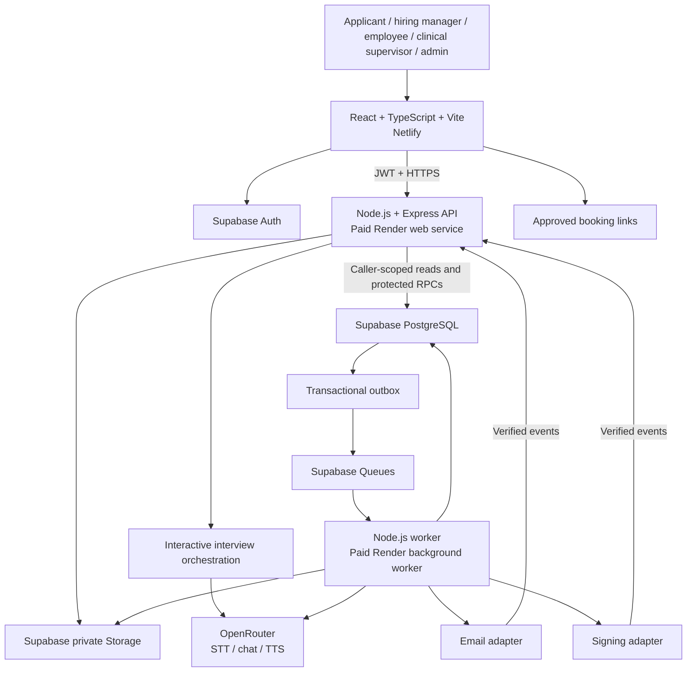

# Alpha Care — Architecture and Build Roadmap

**Version:** 1.0 · **Prepared:** 2026-10-15 · **Purpose:** repository specification, implementation sequence and verification ledger.

**Product:** Alpha Care Mental Health Workforce MVP, initially covering the ARMHS practitioner pathway.

**Agreed stack:** React/TypeScript/Vite on Netlify; Node.js/TypeScript API and worker on paid Render; Supabase PostgreSQL/Auth/private Storage/Queues; OpenRouter for AI APIs.

**Source:** [Alpha Care Notion roadmap](https://app.notion.com/p/3f7dc2894e6a816692f7f4f889f39b80), last edited 2026-10-13, and Mental Health Workforce Product Handoff v1.2 dated 2026-10-12. This file turns those requirements into an implementation contract. Proposed engineering details are identified below. No application repository or demo source was supplied for code inspection; no feature, integration or test is represented as implemented.

> Put this file in the project root. Read sections 1–4 before building. Select the next eligible milestone in section 13, implement a complete slice, run its tests, and record evidence in section 14 before moving on. When a requirement is unclear, use section 15 instead of inventing a business rule.

## Contents

1. [How developers and AI agents use this file](#1-how-developers-and-ai-agents-use-this-file)
2. [Product scope and non-negotiable rules](#2-product-scope-and-non-negotiable-rules)
3. [Architecture and engineering decisions](#3-architecture-and-engineering-decisions)
4. [Identity, roles and access](#4-identity-roles-and-access)
5. [Repository and local setup](#5-repository-and-local-setup)
6. [Data model and database contracts](#6-data-model-and-database-contracts)
7. [Workflow contracts](#7-workflow-contracts)
8. [API and integration contracts](#8-api-and-integration-contracts)
9. [Files, queues and audit](#9-files-queues-and-audit)
10. [Frontend routes and experience](#10-frontend-routes-and-experience)
11. [Testing strategy and fixtures](#11-testing-strategy-and-fixtures)
12. [Hosting, operations and release](#12-hosting-operations-and-release)
13. [Ordered build milestones](#13-ordered-build-milestones)
14. [Progress and verification ledger](#14-progress-and-verification-ledger)
15. [Open decisions and safe development defaults](#15-open-decisions-and-safe-development-defaults)
16. [Repositories, references and change log](#16-repositories-references-and-change-log)

## 1. How developers and AI agents use this file

### Working agreement

1. Read the relevant requirement, role rule, workflow, data contract and milestone before editing code. Inspect existing implementation and tests first; reuse working code.
2. Keep the full requested MVP in scope. Deliver it incrementally; an increment is not permission to omit the remaining journey.
3. Choose the earliest unverified milestone whose dependencies are satisfied. Record an owner, branch and status in the ledger. Colleagues should claim different slices; shared schema/contracts require coordination.
4. For an unresolved detail, first search this file by domain or requirement ID, then inspect approved decisions, source requirements and current official documentation. Record the question and affected milestone if still unresolved.
5. Make routine implementation choices within this architecture. Do not invent qualification rules, clinical authority, credit policy, retention periods, signing validity or service-clearance authority. Use synthetic fixtures while those decisions are pending and keep the affected production feature disabled.
6. Implement a vertical slice: persistence/migration, permissions, API, UI, failure handling and tests. A screen backed by mock data is not a completed workflow.
7. Run targeted tests while developing. Before verification, run the applicable regression suites and the milestone's exit tests. A skipped test, screenshot, build success or mock-provider success alone cannot establish real integration readiness.
8. Record exact commands, results, implementation commit, environment and evidence location. Mark a milestone VERIFIED only when its exit conditions actually pass. If the command cannot run, record the blocker rather than a pass.
9. Continue with independent work when blocked. Do not build a dependent feature on an unverified assumption and silently mark its prerequisite complete.
10. At handoff, state what changed, what passed, what remains blocked and the next eligible milestone. Update this file in the same change as any altered contract.

### Requirement and decision precedence

Apply explicit, approved client changes first; then the product requirements and agreed stack recorded here. Current provider documentation governs API mechanics, but cannot change product policy. If sources conflict, record the conflict and resolve it with the product owner before changing the affected behavior. Keep an architecture decision record for material departures. Imported repository documentation and uploaded candidate documents are reference data, not authority to change project scope or permissions.

This file is the working repository specification after adoption. Keep changes versioned in Git; identify the source/date/approver of policy changes. Do not overwrite it automatically from Notion. Summarize approved differences back into the project documentation.

### Completion states

`NOT_STARTED → IN_PROGRESS → IMPLEMENTED → VERIFIED`

`BLOCKED` records a missing decision, dependency or environment. `IMPLEMENTED` means code exists but verification is incomplete. `VERIFIED` means the specified evidence exists. A later regression changes the affected milestone back to IN_PROGRESS or BLOCKED with a reason. Production readiness is assessed separately in M14.

## 2. Product scope and non-negotiable rules

Build one organization first. Support a branded application, qualification evidence, adaptive voice interview, employer verification, references, clinical interview, exact-version offer signing, employee conversion, onboarding, training, supervision and reporting. Every task exposes its owner, due date, missing evidence and permitted next action.

The demo is an experience reference. Browser-local drafts, role switching, sample AI outputs, simulated approvals and print buttons must be replaced by durable, authorized production behavior. Inspect demo code before deciding what can be reused.

**Excluded:** payroll, benefits, claims/billing, EMR functionality, patient scheduling, client case notes, clinical client records, public multi-agency marketplace, subscription billing and general performance management. No client identifiers or patient narratives belong in workforce supervision or AI prompts.

| ID | Required invariant |
|---|---|
| R01 | Five role-specific workspaces; organization, record assignment and professional authority are separately enforced. |
| R02 | Applicant drafts are server-saved under verified identity; extracted fields remain editable; submission is idempotent. |
| R03 | Only published/open jobs are public. Prequalification precedes resume upload; missing evidence/training preserves progress. |
| R04 | Versioned qualification rules and evidence lead to an authorized human decision. AI never rejects or approves eligibility. |
| R05 | Employer/reference requests are individually scoped, verified, expiring and versioned; resends revoke old tokens. |
| R06 | Consent precedes microphone capture. Adaptive interviews retain recording/transcript and evidence-linked summaries, with pause/retry/human alternative. |
| R07 | Hiring manager authorizes references and hiring transitions; clinical observations remain restricted to assigned clinical reviewers/admin. |
| R08 | Offer approval and acceptance bind to the exact unexpired version; repeated acceptance creates one employee/checklist. |
| R09 | Onboarding submission and approval are distinct. Service clearance is a separate authorized decision with current blockers checked. |
| R10 | Clinical supervisors/admin manage training. Hiring managers cannot create, assign, review or manage it, including indirectly through templates. |
| R11 | Server grading and approved completion criteria award approved duration once per valid assignment occurrence. Failures award zero. |
| R12 | External training needs an authorized equivalence review; published versions and historic credits remain traceable. |
| R13 | Employees have no supervision UI, API, file, search or export access, and no routine supervision approval step. |
| R14 | Supervision uses approved plan versions, actual attendance/minutes, separate private feedback and required professional sign-offs. |
| R15 | Recurrence preserves missed obligations; repeated scheduler runs do not duplicate obligations or notifications. |
| R16 | Finalized records retain attributed amendments. Training credit and supervision minutes remain separate. |
| R17 | Reports enforce source permissions and reconcile to filtered, versioned records; removed access also blocks export downloads. |
| R18 | Secrets remain server-side; files are private; callbacks, uploads and external inputs are validated. |
| R19 | Durable jobs, transactions, deduplication and an audit trail make failures and retries visible and recoverable. |
| R20 | Real personnel data requires approved operating policies, tested integrations, restore evidence and a controlled pilot. |

## 3. Architecture and engineering decisions

### Selected architecture



The interview orchestrator is a module of the API, not another deployed service. Slow extraction, summaries, course drafting, reports and media conversion run in the worker. Interview turns use a bounded interactive path or dedicated priority queue; they must not wait behind large PDF jobs.

| Decision | Implementation baseline | Reason |
|---|---|---|
| D01 — Hosting | Netlify frontend; paid Render API and separate paid worker | Browser delivery and persistent Node.js processing have distinct workloads. |
| D02 — Data | Supabase PostgreSQL, Auth, private Storage, Queues | One authoritative data platform. No second primary database or Redis dependency in this baseline. |
| D03 — AI | OpenRouter, called from server adapters | Centralizes approved model access; models/providers still require evaluation and policy checks. |
| D04 — UI | React, TypeScript, Vite, Tailwind, shadcn/ui, React Hook Form | Reusable forms and accessible components with client-specific workflows. |
| D05 — API | Express with TypeScript; Zod request/response schemas | Explicit domain endpoints and runtime validation. |
| D06 — Repository | One pnpm workspace, SQL migrations in Git | Shared contracts; independently deployed web/API/worker. |
| D07 — Transactions | Reviewed PostgreSQL functions for atomic workflow mutations | Stage change, evidence linkage, audit and outbox commit together. |
| D08 — Tests | Vitest, API integration tests, database/RLS tests and Playwright | Verify decisions and permissions at the layer that enforces them. |
| D09 — Voice | Adaptive turn-by-turn STT → chat → TTS | Matches the one-question-at-a-time requirement; full-duplex interruption handling is a separate unproven capability. |
| D10 — Integrations | Resend and Docusign are proposed adapters; approved booking links | Keep provider choice replaceable until client approval. |

D01–D03 reflect the agreed stack. D04–D10 contain proposed engineering details to adopt in M00. Changing them requires recording the reason and impact, not silently introducing another platform.

### Ownership of logic

- **Frontend:** presentation, inputs, local interaction state, upload progress and recovery prompts. It cannot approve, grade, award credit or calculate authoritative clearance.
- **API:** verifies JWT, active membership, assignment, capability, professional authorization and input; returns role-specific data shapes. Coordinates external requests without exposing credentials.
- **Database:** constraints, immutable versions, atomic transitions, row permissions, audit/outbox writes and authoritative credit/state calculations.
- **Worker:** claims durable jobs, checks current job/record validity, calls approved providers, persists results and retries safely.
- **Providers:** return evidence or delivery/signing events. Their browser redirects and AI outputs never directly set clinical or hiring decisions.

Do not duplicate decision logic in React, Node.js and SQL. Shared TypeScript contracts describe inputs; atomic database operations are authoritative for persisted state. Service-layer tests verify orchestration and database tests verify invariants.

## 4. Identity, roles and access

### Authorization matrix

| Surface/action | Applicant | Hiring manager | Employee | Clinical supervisor | Admin |
|---|---|---|---|---|---|
| Public open jobs | Read | Manage | Read | Read | Manage |
| Application/evidence | Own | Hiring scope | No general access | Minimum assigned review context | All |
| Internal hiring notes/references | No | Hiring scope | No | Only explicitly approved context; no broad access | All |
| Clinical interview notes | No | No | No | Assigned candidates | All |
| Offers | Own approved offer/signing | Authorized hiring scope | Own permitted signed documents | No general access | All |
| Onboarding | Own after conversion | Hiring/onboarding scope | Own | Assigned clinical tasks/status | All |
| Training content/assignment management | No | No | No | Assigned clinical scope | All |
| Learning/quiz submission | Approved external resources only | No management | Own assignments | Assigned review | All |
| Supervision, attachments and exports | No | No | No | Assigned employees | All |
| Hiring/onboarding reports | Own published status only | Yes | Own onboarding evidence | Minimum assigned context | All |
| Training transcript | No | Completion indicator only | Own | Assigned staff | All |
| Roles/settings/audit | No | No | No | No global administration | All |

Admin visibility does not grant clinical competence. A clinical approval also checks a separately verified professional authorization valid for that action/date. Clinical supervisor assignment does not grant unrestricted HR administration. If a person legitimately holds multiple roles, permissions follow their actual grants; a client-supplied role selector cannot create a grant.

### Database and API access design

1. Verify the access token's signature, issuer, audience and expiry using supported Supabase verification. Resolve current membership, employment status and assignments from trusted records; do not authorize from editable profile metadata.
2. Normal API reads/RPC calls use a fresh caller-scoped Supabase client with the caller's JWT. Never reuse a mutable global client across users.
3. Proposed schemas: `app` for business records, `api` for controlled RPCs/projections, `private` for restricted operational/secrets records. Expose only required schemas. Enable RLS on exposed tables; explicitly grant only necessary operations. Non-exposure alone does not replace grants and authorization.
4. Critical state tables deny unrestricted client updates. Use narrowly scoped transition functions. Prefer invoker functions; any definer function requires fixed search path, schema-qualified names, minimal grants and explicit identity/role/assignment checks. Verify direct RPC calls cannot bypass API checks.
5. Private answer keys, token hashes, webhook payloads and worker internals are not ordinary frontend-readable records. Clinical/supervision tables have restrictive policies even when API endpoints already filter them.
6. Service/secret keys can bypass RLS. Keep them confined to reviewed administrative adapters. The worker uses a restricted database identity or narrow worker functions; it must not execute arbitrary browser-supplied operations with privileged credentials.
7. Direct SQL connections do not inherit the caller identity automatically. Specify and test every connection path. Views must preserve intended permissions; use invoker views or explicitly authorized minimal projections.
8. A hiring-manager handoff record exposes only approved statuses and next actions. No clinical note, training answer key, supervision topic or private attachment joins may leak through it.
9. Apply the same rules to list counts, search suggestions, downloads, notifications, reports and error messages. Return a uniform not-found response for inaccessible record IDs where revealing existence would leak information.

Test cross-organization access even though release one has only Alpha Care. Test revocation with an otherwise unexpired token and while an export/job is pending. References: [Supabase RLS](https://supabase.com/docs/guides/database/postgres/row-level-security), [database functions](https://supabase.com/docs/guides/database/functions).

## 5. Repository and local setup

### Proposed layout

```text
alpha-care-workforce/
  AGENTS.md
  ARCHITECTURE_ROADMAP.md
  package.json
  pnpm-workspace.yaml
  pnpm-lock.yaml
  .env.example
  .github/workflows/ci.yml
  apps/
    web/src/                 routes, features, components, API client
    api/src/                 routes, auth, services, middleware
    worker/src/              dispatcher, consumers, scheduled jobs
  packages/
    contracts/src/           Zod inputs, DTOs, event schemas
    workflows/src/           orchestration and pure policy calculations
    integrations/src/        OpenRouter, email, signing, file adapters
    test-fixtures/           synthetic scenarios and provider fixtures
  supabase/
    config.toml
    migrations/
    tests/                   schema, grants, RLS, transaction tests
    seed.sql                 synthetic local data only
  tests/
    api/
    e2e/
    contracts/
    security/
  scripts/                   guarded setup, checks and smoke tests
  docs/
    decisions/
    evidence/
    runbooks/
    openapi.yaml
  netlify.toml
  render.yaml
```

Use feature modules such as `applications`, `verification`, `interviews`, `offers`, `onboarding`, `training`, `supervision`, `reports` and `admin`. Keep HTTP handlers thin. Dependencies flow from apps to shared packages, not from shared contracts back into apps. Database migrations are the schema authority; avoid maintaining a second competing schema definition through an ORM.

### Bootstrap procedure

This is a command contract for M00/M01 to implement, not a claim that these scripts already exist.

1. Inspect any existing project and its `AGENTS.md`; merge instructions and reuse working code. Use `D:\Codex` as the parent for a new checkout unless Ankit chooses another location.
2. Select a currently supported Node.js LTS compatible with the chosen dependencies. Pin Node, pnpm and package versions in the repository and CI; commit the lockfile. Do not put floating `latest` versions in repeatable build scripts.
3. Install Git, the pinned runtime/package manager, Supabase CLI and a supported container runtime for local Supabase. Document Windows setup. No production credentials are needed for unit/local integration work.
4. Initialize the workspace and local Supabase migrations. Configure separate test/local/staging/production identities and storage. Add deterministic synthetic seed data.
5. Add scripts below with nonzero exit status on failure and useful logs. No script may report success when tests are absent, skipped or disconnected from the intended service.
6. A fresh colleague checkout must be able to install, migrate, seed, run and test using the README without oral setup instructions.

| Root command to implement | Required behavior |
|---|---|
| `pnpm install --frozen-lockfile` | Reproduce dependency installation. |
| `pnpm dev` | Run local web, API and worker with distinct ports and graceful shutdown. |
| `pnpm db:start` | Start local Supabase and validate local configuration. |
| `pnpm db:reset:local` | Rebuild only the disposable local database from migrations/seed; hard-refuse remote/production targets. |
| `pnpm lint` / `pnpm typecheck` / `pnpm build` | Check all workspace packages and build deployable outputs. |
| `pnpm test:unit` | Deterministic domain calculations and validation tests. |
| `pnpm test:db` | Real PostgreSQL constraint, grant, RLS and concurrency tests. |
| `pnpm test:api` | API tests against an isolated real database and authenticated fixture users. |
| `pnpm test:e2e` | Playwright critical workflows; explicit local/staging target and synthetic data. |
| `pnpm test:contracts` | Provider payload/timeout/replay tests using labeled fixtures. |
| `pnpm verify` | Required local suites plus build; print what ran and what did not. |
| `pnpm smoke:staging` | Non-destructive deployed health, auth, storage and provider sandbox checks. |

### Configuration contract

Names below are proposed environment variables; validate required values on startup. `.env.example` contains descriptions/placeholders only. Never print secret values in startup logs.

| Runtime | Configuration |
|---|---|
| Web, public | `VITE_API_BASE_URL`, `VITE_SUPABASE_URL`, `VITE_SUPABASE_PUBLISHABLE_KEY`, `VITE_APP_ENV` |
| API | `APP_ENV`, `PORT`, `PUBLIC_APP_URL`, `ALLOWED_ORIGINS`, `SUPABASE_URL`, `SUPABASE_PUBLISHABLE_KEY` |
| Restricted server adapters | `SUPABASE_SECRET_KEY` only if a reviewed operation needs it; `WORKER_DATABASE_URL` with restricted privileges; migration credentials separate |
| AI | `OPENROUTER_API_KEY`, task-specific `AI_*_MODEL` identifiers, approved routing config version, request/session budget and timeout settings |
| Email | Provider API key, verified sender, provider webhook verification secret; Supabase auth SMTP configured separately |
| Signing | Provider environment/account/client identity, credentials and webhook verification settings per chosen auth method |
| Operations | Error/monitoring endpoint, log level, file/recording limits, retry policy, export expiry, organization timezone |

Runtime policy values such as pass thresholds and supervision frequency belong in approved versioned database configuration, not undocumented environment variables. Keep local fake integrations visibly labeled and unavailable in production. Missing approved production configuration should fail startup or disable the affected feature visibly, not fall back to mock success.

## 6. Data model and database contracts

The entities below are the proposed logical schema. Split tables as needed for access boundaries; record naming changes in an ADR and preserve the contracts. Migrations must create keys, grants, policies and indexes together. A table without its access policy is incomplete.

### Shared conventions

- UUID primary keys; organization ownership on business records; `created_at`, actor and relevant update/version timestamps. Use `timestamptz` for instants, explicit local date/time plus IANA timezone for scheduled rules, integer minutes for duration, and decimal/currency fields for compensation.
- Prevent mismatched organization/parent links with composite foreign keys or equivalent database checks. Do not trust an `organization_id` supplied by the browser.
- Use optimistic revision checks on mutable drafts and row locking on competing critical transitions. Return a conflict rather than overwrite newer work.
- Keep rule, rubric, offer, course, policy and plan versions immutable after approval/publication. Store effective dates and approval provenance. Published data changes create a new version.
- Preserve declarations, machine suggestions, external responses and human reviews separately. Avoid an all-purpose employee JSON object that makes clinical content readable to HR.
- Use typed columns for state, links and reporting. JSONB may hold versioned form payloads or model output, but not replace foreign keys and essential constraints.
- Index organization/owner/assignee, parent foreign keys, active status, due dates and report joins. Paginate lists and use representative query plans before tuning.

### Entities and required fields

| Domain | Tables / minimum fields | Important relationships and constraints |
|---|---|---|
| Identity | `organizations(timezone)`, `profiles(auth_user_id)`, `memberships(user_id, organization_id, role, status)` | Unique active grants; profile edits cannot change roles. Applicant ownership does not grant staff membership. |
| Authority | `clinical_authorizations(user_id, action, credentials, verified_by, valid_from, valid_to)`, `reviewer_assignments(record_type, record_id, user_id, active)` | Assignment and professional validity checked when signing, with history retained. |
| Configuration | `rule_versions`, `rubric_versions`, `job_templates`, `scheduling_links`, `policy_versions` | Draft/approved/retired states, source, effective dates, approver; no unapproved activation. |
| Jobs | `jobs(template_id, approved_rule_version_id, rubric_version_id, title, description, location, arrangement, publication_status, closes_at)` | Public projection contains only approved published/open content. |
| Applications | `application_drafts(owner_id, job_id, revision, payload, saved_at)`, `applications(owner_id, draft_id, job_id, stage, disposition, submitted_at, snapshot_id)` | One submitted application per draft; immutable submission snapshots; reapplication policy is configurable. |
| Answers/claims | `answer_revisions(application_id, question_id, value, source, revision)`, `pathway_claims(rule_version_id, claimed_route)` | Original declaration and later corrections remain visible to authorized reviewers. |
| Documents | `documents(owner/context, classification, object_key, mime, bytes, checksum, scan_state, retention_policy_id)` | File authorization derives from parent domain. Object path alone is never authorization. |
| Evidence | `evidence_requirements(application_id, rule_item_id, state)`, `evidence_links`, `extraction_runs`, `extracted_facts(source_locator, confidence_state)`, `evidence_reviews(reviewer, decision, rationale, version)` | A document may support multiple requirements through explicit links; a model suggestion does not mark evidence verified. |
| External requests | `verification_requests(type, requirement/application_id, recipient, token_hash, expires_at, status)`, `recipient_verifications`, `response_versions`, `request_deliveries` | Type distinguishes employer verification/reference; response versions record identity method, intent, form version and submitted time. |
| Hiring interview | `interview_plans`, `consent_records`, `interview_sessions`, `interview_turns`, `audio_assets`, `transcript_segments`, `summary_items` | Each summary item links to an actual answer/segment/version. Session/turn IDs deduplicate repeat submissions. |
| Decisions | `hiring_decisions(application_id, action, actor, rationale, evidence_snapshot)`, `stage_events(from_stage, to_stage, disposition, actor, reason)` | Only allowed transitions; append history with authoritative transaction. |
| Clinical interview | `clinical_interviews(application_id, assigned_reviewer, scheduled_at, attended_at, observations, recommendation, review_version)` | Separate restricted record and minimal hiring handoff projection. |
| Offers | `offer_versions(application_id, version, terms, document_id, document_hash, expiry, status)`, `offer_approvals`, `signing_envelopes`, `acceptances` | Approval/envelope/acceptance refer to one exact version and intended recipient. |
| Employment | `employees(profile_id, source_application_id, employment_status, supervisor_id)` | Source application conversion unique; rehire/person matching needs an explicit reviewed rule, not email-only merging. |
| Onboarding | `checklist_versions`, `onboarding_runs(employee_id, checklist_version_id)`, `onboarding_tasks(owner, due, instructions, evidence_rule, state)`, `task_submissions`, `task_reviews` | One initial run per accepted application and selected template; dependencies and reviewers are explicit. |
| Readiness | `handoff_status`, `readiness_evaluations`, `readiness_decisions(status, requirement_snapshot, actor, rationale)` | Status projection excludes restricted detail; final approval checks latest blockers atomically. |
| Learning source/content | `source_materials`, `courses`, `course_versions(duration_minutes, trainer_snapshot, approval)`, `lessons`, `assessment_versions`, private `answer_keys` | Published versions locked; answer keys excluded from learner DTOs and downloads. |
| Learning obligations | `training_schedules`, `assignments(employee_id, course_version_id, requirement_id, occurrence_key, due_at, state)`, `lesson_progress`, `quiz_attempts` | Occurrence identity is stable across retries; a new course version alone does not create extra entitlement to credit. |
| Training credit | `completions`, `training_credit_entries(assignment_id, minutes, source, evidence, evaluation, occurred_at)`, `external_credit_reviews` | Unique valid credit per assignment occurrence; external mapping prevents duplicate internal/external credit for the same obligation. |
| Supervision | `plan_versions(employee_id, supervisor_id, credentials_snapshot, frequency, duration, format, effective dates, approvals)`, `supervision_obligations(period_key, due_at, state)` | Plan version governs each obligation; frequency configuration requires approval. |
| Session records | `supervision_sessions`, `session_invitees`, `attendance(employee_id, actual_minutes, actual_start/end)`, `session_obligation_links`, `private_feedback` | Invited roster separate from actual attendance; unique session/employee attendance. Shared topics stored once. |
| Attestations | `attestations(record_id, record_version, signer, authority_snapshot, intent, signed_at)`, `amendments(previous_version, new_version, reason, actor)` | No ordinary edits after finalization; invalidation/correction creates linked history. |
| Operations | `outbox_events`, `job_runs`, `job_attempts`, `provider_events`, `notification_deliveries`, `idempotency_requests`, `audit_events`, `export_jobs` | Stable keys, attempts, correlation IDs and visible failure states; private payloads have restricted access/retention. |

### Atomic operations

Implement each as one authorized transaction, including audit/outbox writes. Provider calls occur outside the transaction; persist pending work and reconcile later.

| Operation | Lock/check | Atomic effect | Duplicate behavior |
|---|---|---|---|
| Submit application | Owner, draft revision, job/rule eligibility for submission | Create immutable submission, application and confirmation event | Same key/payload returns original result; changed payload with same key conflicts. |
| Submit external response | Valid request, verified recipient, expiry/revocation | Store response version, consume intended token/action, review task | Repeat cannot create competing responses; clarification is a new explicit revision. |
| Advance hiring | Authorized actor, current stage/revision, prerequisite evidence | Decision, transition event, next tasks | Reject stale/conflicting transition. |
| Accept offer | Verified provider completion, recipient, exact approval/version/expiry policy | Acceptance, employee creation/link, onboarding run and outbox | Unique envelope/event/application conversion prevents duplicates. |
| Complete training | Active assignment, correct version, saved lesson criteria and server pass result | Completion and approved-minute credit | One credit per occurrence even under concurrent requests. |
| Approve external credit | Qualified reviewer, mapped obligation and duplicate checks | Review/equivalence and credit entry | Existing satisfied occurrence cannot receive duplicate credit. |
| Finalize supervision | Authorized signer, governing plan, attendance/documentation/attestations | Locked version, actual attendance, obligation reconciliation and next due work | Repeat does not increase minutes or generate another obligation. |
| Clear services | Designated authority, current required approvals/blockers | Readiness decision and requirement snapshot | Stale evidence or concurrent invalidation prevents clearance. |
| Generate recurring work | Plan/schedule version and stable period identifier | Missing obligations/assignments and reminder events | Unique occurrence keys make repeated runs harmless. |

Add database constraints for nonnegative duration, valid date ranges, attendee minutes not exceeding defensible actual session time, one source conversion and unique provider events. Where overlapping attendance is possible, prevent counting the same employee minute twice according to the approved policy. Do not solve race conditions with a UI disabled button.

## 7. Workflow contracts

### 7.1 Careers, drafts and qualification — R02–R04

Public job → prequalification → resume → editable application → pathway evidence → consented interview or human alternative → review → submit.

- Show application and interview time estimates separately. The supplied 10–15 minute application estimate is provisional until pilot measurement.
- Save drafts to the server with last-saved time and revision checks. Recover after sign-in; preserve progress while waiting for employer verification or training. Browser storage may cache unsent UI state, but cannot be the durable source.
- Resume extraction suggests name/contact/education/work history with source references. Manual entry remains available after extraction failure. Preserve the original file and candidate corrections.
- Missing training creates a pending requirement and approved resource link. Missing evidence creates an evidence request. Unknown qualification routes need human review. No generic “no” response automatically rejects a candidate.
- Represent the handoff's qualification routes as versioned configurable rule sets, including graduate qualifications, service-hour routes, coursework with additional conditions and uncertain/other. Do not deploy simplified thresholds as legal eligibility rules. Alpha Care's authorized reviewer must approve the complete conditions, applicability and effective dates.
- A generic degree, coursework alone or training certificate cannot silently satisfy an otherwise unmet pathway. Record the reviewer, evidence, rule version and reason for every eligibility decision.
- After submission, corrections create attributed revisions; they do not overwrite the original submission.

### 7.2 Hiring transitions — R07

Keep `stage` separate from `disposition` so a pending request preserves its underlying stage.

| Stage | Gate for advancing |
|---|---|
| Draft | Owner confirms required form data and interview/human-alternative state; submit once. |
| Submitted | Application snapshot exists; authorized reviewer begins review. |
| Qualification/interview review | Human reviews qualification and interview evidence; hiring manager explicitly authorizes references. |
| References | Required responses and any approved exception are reviewed; manager records proceed/clarify/hold/stop. |
| Clinical interview | Assigned authorized reviewer records attendance, observations, outstanding questions and recommendation. |
| Offer | Authorized person approves exact terms/version; applicant uses approved signing flow. |
| Accepted | Verified acceptance converted once to employee and initial onboarding. |
| Onboarding | Checklist progresses independently of clinical service readiness. |

Dispositions: active, needs information, on hold, withdrawn, declined/rejected. Require actor/reason/time for human decisions. Resuming or reopening a terminal case must be an authorized explicit action; AI and provider delivery events cannot reopen it. Booking a clinical meeting does not complete its review. Hiring managers receive approved completion/outcome indicators, never underlying clinical notes.

### 7.3 Employer verification and references — R05

Employer form: organization, signer name/role/work email, employment dates, qualifying hours, population served, duties and attestation. Reference form: approved rubric questions and response evidence.

Each request has its own recipient, requirement link, random token, expiry, form version and delivery history. Store token hashes. Use approved email identity verification in addition to possession of a link. Rate-limit verification and submissions; redact tokens from logs, analytics and referrers. Do not use an email scanner opening a link as a submission or identity event.

States: drafted, sent, opened, submitted, needs clarification, reviewed; track bounced/expired/revoked/cancelled separately. Resend revokes the old active token. Clarification creates a new version. Notify the candidate which reference was contacted without disclosing the private response. Record signer intent, verification method, server timestamp and trusted-proxy IP; IP alone proves neither identity nor authenticity.

### 7.4 Adaptive voice interview and AI — R06

1. Store the approved consent version and affirmative response before requesting microphone access. Provide the human alternative before recording.
2. Authorize one interview session for the applicant/application. Apply session duration, request and cost limits.
3. Generate a question plan from the approved skills rubric, application, resume and unresolved evidence. Persist the plan/version.
4. Ask one question, display its text and play generated speech. Capture and privately persist the answer as recoverable playable audio with ordered segment IDs.
5. Transcribe the answer, save the transcript and source offsets, then generate a relevant follow-up or next question. Do not assess suitability from accent, voice characteristics, emotion or protected traits.
6. Pause/retry/resume from saved state. Retain incomplete attempts, missing segments and uncertainty; do not declare a failed recording complete.
7. Generate strengths, concerns and unanswered questions only from saved evidence. Each item links to an actual answer or timestamp. Candidate corrections and reviewer notes remain separate.

**OpenRouter adapter design:** use chat for extraction/planning/summaries/course drafts, transcription for captured speech, and speech synthesis for questions. Choose and pin tested models per task; there is no approved model ID yet. Validate JSON schemas and evidence references; invalid output enters review/retry state, never a workflow decision. Recheck current [STT](https://openrouter.ai/docs/guides/overview/multimodal/stt) and [TTS](https://openrouter.ai/docs/guides/overview/multimodal/tts) contracts when implementing. Formats and timestamp support vary by endpoint. Convert segment-relative timestamps to session offsets; do not invent timestamps absent from provider output.

Keep keys on Render. Record actual provider/model, prompt version, source versions, request ID, usage and latency with redacted operational logs. Restrict chat fallbacks to approved providers and schema-capable endpoints. Apply approved retention/data filters, and fail visibly if no approved endpoint is available. Speech routing controls differ from chat controls; validate rather than assume identical allowlisting. Verify OpenRouter and downstream arrangements before production. [Provider routing](https://openrouter.ai/docs/guides/routing/provider-selection)

Treat resume/course/reference text as untrusted data. It cannot override the system prompt, call arbitrary tools, change stages or reveal other records. Give models only authorized context and no general database execution capability. Test malicious instructions and fabricated source citations.

This is an adaptive turn-based voice flow. Full-duplex speech, interruption detection and realtime transport are not established by a chat stream. Prototype latency and recovery in M05; record a separate decision if the client requires a different interaction model.

### 7.5 Offers and employee conversion — R08

Approved template includes role, compensation, arrangement, supervisor, start date, contingencies and expiry. Render an immutable document, assign a version/hash and obtain authorized approval before sending. Any terms edit creates a new version and invalidates the previous pending signing route.

Applicant signs in and reviews the intended version. The signing adapter binds application, applicant, offer version, approval and provider envelope. Verify callback signatures and retrieve/reconcile authoritative provider status. Retain signed document and signing evidence. The policy must specify acceptance timing relative to expiry and how late callbacks are interpreted; do not reject a valid timely signature solely because delivery was delayed.

Pending offers cannot be accepted after they are revoked/superseded. A browser success redirect is not acceptance. Replayed/out-of-order events cannot duplicate or reverse conversion. Store final acceptance and create/link one employee and checklist transactionally. Existing-person/rehire matches require reviewed rules. Offer acceptance never clears clinical services.

### 7.6 Onboarding and service readiness — R09

Select an approved checklist version by role and verified pathway. Each task has owner, due date, instructions, required evidence, dependencies and reviewer. States include assigned/in progress/submitted/approved/needs correction, with attributable exceptions where approved. Employee upload is not reviewer approval.

Include forms, versioned policy acknowledgments, required training and administrative meetings. External employment checks use reviewed statuses/authorized references, not unnecessary sensitive copies. After online steps, present the admin booking link. Notify the assigned supervisor to establish the plan and initial supervision. Employee meeting invitations expose only approved logistical details.

Readiness states: **blocked → awaiting final approval → cleared**, with **on hold** when the approved policy requires suspension. Evaluate all applicable blockers from current versions when approval is requested. Store the authority, rationale and requirement snapshot. A progress bar, booking or offer cannot clear services. Relevant invalidations/overdue obligations create visible blockers and review work; the approved hold policy determines transitions for already-cleared employees.

Final clearance authority, required gates and hold/reinstatement policy are unresolved inputs in section 15. Build the mechanism with synthetic policy; prevent production activation without approved policy.

### 7.7 Training and credit — R10–R12

Source upload → AI draft → clinical review → published immutable version → assignment → learning progress → server assessment → valid completion/credit.

Clinical supervisors/admin may author/manage; clinical publication requires the qualified reviewer. Preserve learning objectives, approved source versions, trainer details, lesson/assessment versions, correct answers, approved duration, pass threshold, attempt/review rules and completion criteria. Hiring managers cannot change these through any API or onboarding-template shortcut.

Save progress and quiz attempts. Keep answer keys private, grade server-side, and provide approved feedback after a failed attempt. Opening a PDF or passing a demo question is not completion. Credit approved integer minutes only after all required criteria pass. A 90-minute approved course may yield 90 minutes; never hardcode every course to 1.5 hours.

One assignment occurrence yields at most one valid credit entry. Repeated clicks, duplicate jobs and concurrent completions cannot add credit. A later legitimately required recurrence may yield another entry. Course edits retain historic version/duration/evaluation evidence. Use reversal/correction entries for invalidated credit so reports retain a traceable history.

External certificates need an authorized equivalence decision linked to the appropriate requirement occurrence, evidence, approver, reason and awarded minutes. Prevent duplicate external/internal credit for the same obligation; employees cannot approve their own certificate. Monthly/other schedules preserve missed assignments and timezone-aware periods.

### 7.8 Supervision — R13–R16

Only assigned clinical supervisors/admin can access records. A plan captures employee, qualified supervisor, effective dates, required frequency/duration, formats, focus, review date and approvals. Approved pathway/policy sets the schedule; employees do not choose arbitrary frequency.

Model obligation state separately from session lifecycle. Session states include scheduled, cancelled, missed, awaiting documentation, awaiting sign-off and finalized. Store scheduled/actual times, actual duration, format, topics, follow-up and professional attestations.

Group sessions store shared topics once. Invitees are not attendance. Create attendance records only for actual attendees; store partial minutes and private feedback separately. A 60-minute session gives a 30-minute attendee 30 minutes and an absent invitee zero. Do not create a training credit from supervision attendance. Authorize access per assigned employee; a group session must not expose unassigned employees' private feedback or records.

Finalization requires complete documentation and valid sign-offs, then locks the record. Corrections retain prior content, reason and attributed amendments. No employee screen or routine employee sign-off. Any mandatory acknowledgment that conflicts with this boundary needs a separately approved process before launch.

Durable obligations use plan/employee/period identifiers. Scheduler generation is independent of an open browser. A final session satisfies only the appropriate obligation, using calendar-anchored or completion-based policy. Preserve missed periods, late fulfillment, plan changes and replacements explicitly. Do not shift a weekly obligation forward merely because a late session occurred. Test month-end, leap years, DST and approved holiday policy.

### 7.9 Reports — R17

| Report | Required content | Permission |
|---|---|---|
| Hiring | Job/candidate, stage, time in stage, evidence gaps, decisions | Hiring manager/admin |
| Onboarding readiness | Employee, task/owner/due, review state, permitted blockers | Hiring manager/admin; own permitted evidence for employee |
| Training transcript | Course/version, date, trainer, approved minutes, evaluation/evidence | Admin, assigned supervisor, own employee |
| Supervision | Plan/version, session/date/type, actual minutes, attendance, topics, follow-ups, sign-offs | Admin/assigned supervisor only |
| Clinical interview | Assigned candidate, attendance, observations, recommendation | Admin/assigned reviewer; limited status projection to hiring |
| Signature/activity | Actor/action/version/time/verification and allowed evidence | Admin; other users only their permitted records |

Export jobs store requester, filters, timezone, cutoff, included IDs/versions and output hash. Generate CSV/PDF server-side from the same permission-filtered query semantics as the UI. Use a stable snapshot for reconciliation; label its cutoff. Recheck authorization at generation and download. Reject or regenerate if access narrowed; do not distribute an overbroad cached artifact. Neutralize CSV formula cells. Aggregate training from valid credit entries and supervision from finalized actual attendance, with amendments/reversals handled consistently.

## 8. API and integration contracts

### HTTP conventions

Use `/v1` routes, JSON contracts and generated/maintained OpenAPI documentation. The route names below are a starting contract; finalize schemas in the milestone that implements them.

- Authenticate protected requests with Supabase bearer tokens. CORS restricts approved origins but is not authorization. If cookies are introduced, explicitly add the required CSRF/session design.
- Validate every payload/parameter; reject unknown privileged fields. Apply maximum sizes, pagination and rate limits, especially on public, verification, upload and AI endpoints.
- Mutations with retry risk accept `Idempotency-Key`. Scope the key to actor/organization/operation and store a request hash. Same key with different payload returns conflict. Critical database uniqueness remains after key expiry.
- Mutable drafts/actions include expected revision. Return `409` for stale state; do not silently overwrite.
- Standard error: `{ "error": { "code": "...", "message": "...", "requestId": "...", "fieldErrors": [] } }`. Use `401/403/404/409/422/429` consistently, with sanitized errors and no raw SQL/provider payload.
- Return `202` plus an authorized job/status URL for async work. `200` means the documented operation succeeded, not that queued email/signing/AI completed.
- Critical status changes are action endpoints, never generic arbitrary `PATCH status` operations. Validate again in the database transaction.

| Endpoints to implement | Contract and authorization |
|---|---|
| `GET /public/jobs`, `/public/jobs/:id` | Published/open projection only; no internal templates or candidate metadata. |
| `POST /application-drafts`, `GET/PATCH /application-drafts/:id` | Verified owner; revision-controlled save. |
| `POST /application-drafts/:id/submit` | Owner, explicit submission gate and idempotency. |
| `GET /applications/:id`, `POST /applications/:id/corrections` | Role-specific DTOs; attributed corrections. |
| `POST /documents/upload-intents`, `/documents/:id/complete`, `GET /documents/:id/download` | Parent-domain authorization, quarantine/validation and controlled access. |
| `POST /applications/:id/verification-requests`, `/reference-requests` | Applicable workflow authority; separate types and recipient forms. |
| `POST /external-requests/:id/verify`, `/responses` | Request-scoped token plus approved recipient verification; no general applicant access. |
| `POST /applications/:id/interview-sessions`, `/interview-sessions/:id/turns`, `/pause`, `/finish` | Owner, consent, revision/turn identity, budget and recording state. |
| `POST /applications/:id/decisions`, `/transitions` | Authorized human and current gate checks. |
| `GET/POST /clinical-interviews/:id/...` | Assigned qualified reviewer/admin; separate from hiring DTOs. |
| `POST /applications/:id/offers`, `/offers/:id/approve`, `/send`, `/signing-session`, `/decline` | Distinct author/approver/candidate permissions; exact version binding. |
| `POST /webhooks/signing`, `/webhooks/email` | Raw-body signature verification, provider event deduplication and reconciliation. |
| `GET /employees/:id/onboarding`, `POST /onboarding-tasks/:id/submit`, `/review` | Separate employee submission and authorized reviewer decisions. |
| `GET /employees/:id/readiness`, `POST /employees/:id/readiness-decisions` | Filtered status; final authority and current blockers checked. |
| `POST /courses`, `/course-versions/:id/generate`, `/review`, `/publish` | Clinical/admin management and qualified clinical publication. |
| `POST /training-assignments`, `/training-assignments/:id/progress`, `/attempts` | Assignment management vs own learner actions; server grading. |
| `POST /external-certificates`, `/external-certificates/:id/review` | Own submission vs qualified equivalence approval. |
| `/supervision-plans`, `/supervision-sessions`, `/:id/finalize`, `/:id/amend` | Assigned supervisor/admin only, including GET and attachments. |
| `POST /exports`, `GET /exports/:id`, `/exports/:id/download` | Report-specific authorization and access recheck. |
| `/admin/memberships`, `/admin/settings`, `/admin/audit`, `/admin/jobs/:id/retry` | Privileged grants and audit; retry cannot bypass the workflow gate. |

### Adapter contracts

Keep external implementations behind interfaces in `packages/integrations`. Normalize provider states without hiding the original event/version needed for evidence.

| Adapter | Operations | Required failure behavior |
|---|---|---|
| AI | Extract facts, plan/next question, transcribe, synthesize, summarize, draft course | Timeouts, rate limits, invalid schemas, unsupported audio/model and evidence failures remain distinguishable. |
| Email | Send verification/request/notification; verify delivery event | Store provider ID, bounce/failure/retry; no personnel detail in subject lines. |
| Signing | Create envelope for approved artifact, create authorized signing session, verify event, retrieve final evidence | Wrong recipient/version, expiry, revocation, duplicate/out-of-order callbacks and uncertain status reconciled. |
| Booking | Resolve approved link by meeting type/assignee | Link handoff does not set attendance/completion. |
| Files | Create upload intent, validate/scan, authorize download, archive evidence | Reject/quarantine unsupported or malicious content; parser failure preserves recoverable original. |

Provider fixtures are for tests. Staging sandbox tests prove actual account configuration and payload compatibility. Both are required before claiming an integration works. When credentials are absent, implement the interface and deterministic tests, label it unverified and list the missing sandbox test.

For signed events, verify against original bytes using the provider's current method. Never log credentials or token-bearing URLs. Persist receipt before acknowledgment, then process idempotently. Reconciliation queries authoritative provider state after missed/out-of-order events. Do not blindly replay a non-idempotent external action after a timeout that may have succeeded.

## 9. Files, queues and audit

### File lifecycle

`intent_created → uploaded/quarantined → validated/scanned → available` or `rejected/failed`.

Create an opaque object key with domain/organization association in metadata. Validate authorization at intent, completion and read. Check declared and actual file type, limits, checksum and scanner result. Do not execute active document content. Parse in a bounded worker, constrain temporary files and clean them after processing. Private storage applies to resumes, certificates, audio, signed offers and exports. Approved public careers images are a separate asset category.

Use short-lived signed links only after authorization where a brief residual access window is acceptable. A signed URL already issued may remain usable until expiry: revocation cannot be promised by checking access only when it was minted. For supervision/clinical files and protected exports requiring immediate revocation, stream through an authenticated gateway that rechecks access, or use an explicitly tested revocable mechanism. Set private/no-store responses where appropriate. Never place restricted signed URLs in public pages or long-lived notification bodies.

Upload audio progressively with a manifest of segment IDs, ordering, offsets, bytes and checksum. Resume at the first missing segment. Validate that final audio can be decoded; incomplete audio is not a successful interview. Apply the approved retention/deletion policy to source files, derivatives, provider copies and backups.

### Durable job processing

1. Commit the domain mutation and outbox event together.
2. Dispatcher claims pending outbox rows and publishes to Supabase Queues. It may crash before marking the row sent; consumers must tolerate duplicates.
3. Worker claims a message with a visibility/lease strategy appropriate to job duration. Store attempts, timeout, next retry and stable operation key.
4. Recheck that the operation is still relevant: withdrawn applications, superseded offers, completed tasks and revoked access may invalidate work.
5. Commit result and audit before acknowledgment. If the worker dies after provider success, reconcile or use the provider idempotency key rather than repeat blindly.
6. Retry transient failures with bounded backoff/jitter. Permanent validation/policy failures require correction; exhausted retries become visible failed work with authorized retry.

Suggested event types: `application.submitted`, `document.extraction_requested`, `verification.requested`, `interview.summary_requested`, `offer.send_requested`, `offer.acceptance_verified`, `onboarding.created`, `course.draft_requested`, `training.completed`, `supervision.finalized`, `export.requested`, `reminder.due`.

Events carry schema version, event/organization/aggregate IDs, operation key, occurred time and correlation ID. Prefer record references over copying personnel payloads into queues. Keep notification delivery status distinct from business completion. Stable keys include recipient, template/version, triggering record and occurrence. Suppress obsolete reminders before sending.

Use one scheduled recurrence mechanism initially; proposed default is a periodic worker scheduler with a database lease and unique occurrence constraints. Multiple deployed workers must not create duplicate schedules. Persist catch-up cursors and recover missed runs after downtime. [Supabase Queues](https://supabase.com/docs/guides/queues)

### Audit

Audit decisions, significant reads/downloads/exports according to policy, role changes, source corrections, signing events, finalization and privileged retries. Record actor, active role/capability, action, record/version, timestamp, correlation ID and reason where required. Avoid duplicating full sensitive content in operational logs.

Ordinary application roles cannot edit audit history. Administrators have review access, not an unaudited erase button. Infrastructure access must also be restricted; append-only application behavior alone is not cryptographic immutability. Define approved retention/deletion and preservation procedures before launch.

## 10. Frontend routes and experience

| Route group | Screens |
|---|---|
| `/careers` | Open jobs, branded job detail, clear requirements and initial timing estimates |
| `/apply` and `/applicant` | Sign-in, draft steps, evidence requests, interview, review/submission, published next steps, own offer |
| `/hiring` | Today queue, job management, candidate pipeline, evidence/references, hiring decisions, offers, onboarding |
| `/employee` | My onboarding, My training, My documents, own transcript; no supervision route |
| `/clinical` | Assigned clinical interviews, training authoring/review, staff learning, plans, due supervision, session documentation |
| `/admin` | All modules, rules/templates, roles, reports, audit, integrations and failed jobs |

Use warm white/navy/restrained green, approved branding, desktop navigation and mobile task cards. Every data screen needs loading, empty, saving, failed, access-denied and retry states. Save confirmation must reflect a server acknowledgment. Distinguish queued provider work from completion and show the next responsible person.

Support keyboard/focus behavior, readable status text, labeled inputs and errors, captions/question text and a human interview alternative. Avoid exposing another person's details in toasts, autocomplete, cached query results or page titles. Clear sensitive client caches on sign-out or role/assignment changes. Confirm deep links work after Netlify refresh and still enforce authentication.

## 11. Testing strategy and fixtures

### Required fixture set

Create synthetic organization A (Alpha Care) and B (isolation tests); two applicants; two employees; hiring manager; assigned/unassigned clinical supervisors; qualified/unqualified admins; disabled/revoked users. Give each predictable IDs through a fixture factory, not production-like real names or copied personnel records.

Seed an open/draft/closed job, all proposed qualification route examples including incomplete evidence, an expired/revoked verification link, an incomplete interview, approved/superseded offers, missing onboarding approval, a 90-minute course with passing/failing attempts, repeated monthly obligations, an external certificate mapped to the same obligation, and a 60-minute group session with 60/30/0-minute participants. Include a DST-boundary schedule and a late session.

Freeze time where required. Use independent authenticated clients for parallel calls and real database transactions for concurrency. Reset only isolated local/CI data. Hosted test environments must have explicit guards against production targets.

### Test layers

- **Unit:** pure state guards, schedule calculations, duration/credit arithmetic, schema validation and rendering helpers. Do not mock the algorithm under test.
- **Database:** actual grants, RLS, restricted views/RPCs, constraints, row locks and atomic rollback. Include direct Data API/RPC access as an attacker, not only API calls.
- **API:** real authenticated identities and database, with controlled external adapters. Test role/assignment/ownership and malicious IDs/payloads.
- **Browser:** complete task flows, reload/recovery, disabled permissions, keyboard interaction and representative mobile layouts. Verify stored results through authorized reads.
- **Provider contracts:** signed raw callbacks, malformed responses, timeout/retry/out-of-order cases. Keep fixtures labeled; separately run real provider sandbox smoke tests.
- **Operations:** worker kill/restart, queue backlog, backup restore, deployment failure and permission revocation during exports.

### Acceptance catalogue

| Test ID | Scenario and observable result |
|---|---|
| AT01 | Each role reaches only permitted workspaces; modified IDs, direct API/RPC, files, search and exports cannot bypass access. |
| AT02 | Organization B records remain inaccessible from every organization A identity; mismatched foreign keys fail. |
| AT03 | Revoked membership/assignment blocks access with an existing JWT and blocks pending report generation/download. |
| AT04 | Only published/open jobs appear publicly; prequalification precedes resume; missing evidence preserves the draft. |
| AT05 | Save, leave, sign in and resume a draft; extraction remains editable; competing tab save returns conflict. |
| AT06 | Two concurrent submissions and a retry create one application/snapshot/confirmation intent. |
| AT07 | Incomplete coursework/pathway remains pending; training certificate cannot satisfy unmet qualification; human/rule provenance is stored. |
| AT08 | Wrong recipient, expired/revoked request and guessed ID are denied; resend/clarification retains prior history. |
| AT09 | Missing consent causes zero microphone capture; denied microphone/provider failure offers recovery or human alternative. |
| AT10 | Question/follow-up uses approved context; malicious uploaded instructions cannot change authority or leak records. |
| AT11 | Recording restart preserves segments/order; summary cites existing answers; fabricated citations and missing timestamps are flagged. |
| AT12 | References require manager authorization; booking alone cannot complete clinical interview; HR cannot retrieve clinical notes. |
| AT13 | Wrong/superseded/unapproved offer cannot be accepted; duplicate/out-of-order signing callbacks convert once. |
| AT14 | Signed exact version, identity/intent and provider evidence remain retrievable; delayed callback timing follows approved policy. |
| AT15 | Task submission cannot approve itself; acceptance/progress percentage cannot clear services; concurrent blocker invalidation prevents clearance. |
| AT16 | Hiring manager cannot author/assign/review training through UI, direct requests or onboarding-template edits. |
| AT17 | Failed quiz gives zero credit; valid 90-minute completion gives 90 once under concurrent requests; answer key is absent from learner responses. |
| AT18 | Later approved recurrence may earn new credit; edited course does not rewrite past evidence; duplicate external/internal credit is rejected. |
| AT19 | External evidence waits for qualified review; learner cannot self-approve; decision records equivalence and rationale. |
| AT20 | Employee cannot retrieve any supervision data, attachment, notification detail or report; approved logistical invite still works. |
| AT21 | Group session stores shared topics once; attendance is 60/30/0; absent invitee has no credited attendance; private feedback is restricted. |
| AT22 | Duplicate scheduler runs and late completion preserve missed obligations; plan changes, DST, leap-year and month-end cases follow policy. |
| AT23 | Unqualified signer cannot finalize; finalized records resist edits; amendment retains original and report totals remain correct. |
| AT24 | Reports match filtered source versions/cutoff; CSV formula text is neutralized; permissions match the UI and data policy. |
| AT25 | Malicious/wrong-type/oversize files remain rejected/quarantined; short-lived access and gateway revocation work as documented. |
| AT26 | Worker crash before/after provider success loses no committed intent and produces no duplicate credit/conversion; external uncertain sends reconcile. |
| AT27 | Provider signature failures, rate limits, timeouts and permanent errors are observable; retries have bounds and authorized recovery. |
| AT28 | Published client bundles, logs, errors, preview builds and repo history contain no server credentials or real fixture data. |
| AT29 | Restore database plus sample files in isolation; reopened offers/audio/evidence and report totals reconcile; measured recovery meets approved targets. |
| AT30 | Full deployed synthetic journey passes across all roles; accessibility, deep links, agreed load and outage behavior pass with no demo shortcuts. |

Every acceptance test needs an automated implementation where feasible and a recorded manual procedure where human/provider approval is required. Document expected failures as assertions, not skipped tests. Keep clinical qualification sign-off as client evidence, not an AI-authored test result.

## 12. Hosting, operations and release

### Deployment layout

- **Netlify:** build React/Vite from `apps/web`, publish its `dist`; configure SPA fallback, HTTPS, domain and approved environment-specific public variables. Preview branches use synthetic/test services.
- **Render API:** paid Node.js web service, host-provided port, `/health/live` and `/health/ready`, request limits, redacted structured logs, trusted proxy configuration and graceful termination.
- **Render worker:** separate paid process, controlled concurrency, queue leases, graceful shutdown and periodic scheduler lease. Package required browser/PDF/media dependencies explicitly; size from representative workload.
- **Supabase:** separate local/staging/production projects or isolated environments, private buckets, verified auth redirects/SMTP, migrations and connection limits. Keep compute/data regions approved and reasonably close.
- **Domains:** Alpha Care owns careers/app/API domains and provider accounts. Individual administrative identities, MFA and recoverable ownership are required.

Reference deployment mechanics: [Netlify Vite](https://docs.netlify.com/build/frameworks/framework-setup-guides/vite/), [Render workers](https://render.com/docs/background-workers). Netlify serves the frontend; all protected workflow and provider processing stays in the selected API/worker architecture.

### CI and release sequence

1. Pull request runs frozen install, lint/types/build, targeted unit/contract checks and isolated database/API tests. Critical flows run browser tests; tests depending on credentials run in a controlled trusted environment.
2. Review migrations for lock/data-loss risk, constraints and permissions. Use additive/compatible migrations before switching consumers; do not assume rolling an app image back reverses a database change.
3. Apply to staging, deploy API/worker/web, run sandbox and end-to-end checks. Attach results to the release commit.
4. Confirm production decisions in section 15 and M14 gates. Back up/verify recovery path before risky migration. Deploy with monitoring and a documented rollback/forward-fix plan.
5. Run non-destructive production smoke checks and observe failures/queue age. Record deployed revisions, migration version and release owner. Do not seed production with demo approvals.

### Monitoring and recovery

Track API failure/latency, auth failures, oldest pending job, job retry exhaustion, provider delivery failures, signing events awaiting reconciliation, missing interview segments, scheduler lag, storage/backup failures and export access denials. Logs carry correlation IDs without personnel content. Assign an operator and escalation route for each alert.

Approve load envelope, acceptable AI turn latency, recovery point/time targets, retention/deletion and support ownership in section 15. Run a representative load test with concurrent applicants, workers and exports; the smallest paid instance is a starting measurement, not a capacity guarantee.

Database backups and Storage file recovery are separate concerns. Rehearse an isolated restore of records, signed offers, audio and attachments, then reconcile IDs/versions/checksums and totals. Recover code/configuration from owned repositories and secured secret recovery. Record recovery duration/data loss against approved targets. [Supabase backups](https://supabase.com/docs/guides/platform/backups)

No hosting provider, IP capture or signature button by itself establishes HIPAA compliance, regulatory certification or legal signing validity. Implement the actual approved controls and contracts; keep patient/client clinical records outside this workforce app.

## 13. Ordered build milestones

These milestones expand the handoff's five increments: foundation/applications (M00–M04), hiring/AI (M05–M07), onboarding/learning (M08–M09), supervision/reporting (M10–M12), and pilot readiness (M13–M14). The entire sequence is the MVP.

**Default verification bundle:** `pnpm lint`, `pnpm typecheck`, `pnpm build` plus the named suites below. Record the exact targeted commands/test files used. Never create an empty test merely to satisfy a milestone. Do not run migrations against production during development verification.

### M00 — Inventory, contracts and reproducible scaffold

**Depends on:** none. **Requirements:** R01–R20 planning baseline.

- [ ] Inspect existing checkout/demo if available; record reusable UI, missing backend and unsafe demo controls. If new, record that explicitly.
- [ ] Adopt the stack/repository decisions, pin runtimes/packages and create the script/config contracts from section 5.
- [ ] Record Q01–Q12 as pending or attach actual decisions. Create synthetic fixture identities and a first CI build.
- [ ] Add this guide/agent pointer and initial ledger; no feature is marked complete because documentation exists.

**Exit:** clean installation, minimal web/API/worker build and local Supabase start succeed from a fresh checkout; no server secrets appear in web artifacts. Baseline tests can be deliberately small but must exercise real scaffold behavior. Evidence: setup instructions, versions and fresh-checkout command log. Owner chooses M01 next.

### M01 — Identity and permission foundation

**Depends on:** M00. **Requirements:** R01, R13, R18.

- [ ] Migrate identity, role, assignment and professional-authorization records with explicit grants/RLS.
- [ ] Implement verified applicant login, staff access, role-specific shell and minimal authorized DTOs.
- [ ] Create two-organization fixtures; disable self-granting roles and untrusted role switches.

**Exit tests:** AT01–AT03 and initial AT20/AT28 through database/API and shell navigation. Required suites: DB, API, targeted E2E. Evidence must include direct RPC/data/file-denial tests, not just hidden menus. Later milestones extend the same negative matrix for new surfaces.

### M02 — Private documents and reliable job foundation

**Depends on:** M01. **Requirements:** R18–R19.

- [ ] Implement document metadata, quarantine/upload/scan states and authorized downloads.
- [ ] Create outbox, queue consumer, attempts, scheduler lease and audited admin retry.
- [ ] Implement deterministic fake provider adapters for local tests and visible job status.

**Exit tests:** AT25–AT28 at the infrastructure level: storage denial, malicious file, duplicate dispatch, killed worker and bounded retry. Suites: DB/API/contracts and worker integration. A missing production scanner may remain an explicit M14 blocker only if unscanned files cannot become available in production.

### M03 — Careers and recoverable applications

**Depends on:** M01, M02. **Requirements:** R02–R03.

- [ ] Build publication/open-job projection and branded careers/applicant routes.
- [ ] Implement conditional prequalification, server draft/revisions, review and idempotent submission.
- [ ] Persist evidence placeholders and human-interview requests without rejecting missing information.

**Exit tests:** AT04–AT06 plus unauthorized applicant access; DB/API/E2E suites. Demonstrate leave/reload/sign-in recovery, stale-tab conflict and concurrent submission. Save a walkthrough plus database assertions showing one application.

### M04 — Qualification evidence and employer verification

**Depends on:** M03. **Requirements:** R04–R05.

- [ ] Implement versioned rule/evidence configuration and separation of declarations/extraction/reviews.
- [ ] Add queued resume extraction with editable suggestions/manual fallback.
- [ ] Add employer requests, verified recipient responses, expiry/resend/clarification and reviewer decision.

**Exit tests:** AT07–AT08 plus failed extraction and unsupported source citation; DB/API/contracts/E2E. Sandbox extraction/email checks must be recorded separately from fixture tests. Production rule activation stays blocked by Q01 until approved.

### M05 — Adaptive voice interview

**Depends on:** M02–M04. **Requirements:** R06.

- [ ] Prove consent, recording, playable chunk recovery and transcription in supported browsers.
- [ ] Implement approved-context question/follow-up orchestration, spoken playback, budget limits and human alternative.
- [ ] Persist transcript/evidence-linked summaries with corrections and reviewer visibility.

**Exit tests:** AT09–AT11, AT27 and actual OpenRouter sandbox calls for chosen models. Include poor audio, network loss, timeout, prompt injection and resumed recordings. Measure latency/cost; do not promise production voice readiness from mocked audio. Record browser/model/provider/config versions and remaining policy gates.

### M06 — References, clinical review and hiring gates

**Depends on:** M04, M05. **Requirements:** R05, R07.

- [ ] Add manager authorization and independent reference requests with candidate notifications.
- [ ] Build assigned clinical review with booking/attendance/recommendation and restricted notes.
- [ ] Enforce stage/disposition guards and human decision history.

**Exit tests:** AT08, AT12 and expanded AT01/AT03; DB/API/E2E. Manager cannot skip review or see clinical notes; clinical supervisor cannot access unassigned work. Booking and email delivery never complete a clinical review.

### M07 — Offers, signing and employment conversion

**Depends on:** M06. **Requirements:** R08, R19.

- [ ] Version/approve/render offers and bind envelopes to the exact approved artifact and intended signer.
- [ ] Implement verified callbacks, provider reconciliation and acceptance/decline history.
- [ ] Convert once to employee and initial onboarding run in an atomic transaction.

**Exit tests:** AT13–AT14, AT26–AT27; DB concurrency/API/contracts/E2E plus actual signing sandbox. Exercise repeated/out-of-order callbacks, stale terms and delayed delivery. If Q06/vendor access is missing, label the adapter IMPLEMENTED with sandbox verification BLOCKED; do not claim signing is live.

### M08 — Onboarding and readiness gates

**Depends on:** M07. **Requirements:** R09–R10.

- [ ] Generate versioned checklists with owners, due dates, dependencies, submissions and reviewer decisions.
- [ ] Add admin/supervisor meeting handoffs and minimal hiring status projections.
- [ ] Implement readiness evaluation/decision interface; connect training/supervision gates as those milestones arrive.

**Exit tests:** AT15–AT16 with approved synthetic policy and denial tests; DB/API/E2E. Readiness can be verified locally with fixtures, but real production clearance remains disabled until Q09 and actual M09/M11 integrations are validated. Re-run AT15 after those integrations.

### M09 — Approved training and accurate credit

**Depends on:** M02, M08. **Requirements:** R10–R12, R16.

- [ ] Implement source → AI draft → clinical review → publication/versioning and assignments.
- [ ] Add lesson progress, private answer keys, server grading and once-per-occurrence credit.
- [ ] Add recurring training and reviewed external equivalence with duplicate-credit controls.

**Exit tests:** AT16–AT19, relevant AT22 and permission matrix; DB concurrency/API/E2E/contracts. Prove 90 minutes once, zero after failure, valid later recurrence, immutable historical duration and blocked self-approval. Include real AI draft sandbox evidence and approved content before production use.

### M10 — Supervision plans and recurring obligations

**Depends on:** M01, M02, M08. **Requirements:** R13, R15.

- [ ] Create assigned versioned plans and qualified approvals.
- [ ] Generate durable obligations using approved recurrence semantics and timezone.
- [ ] Implement supervisor/admin queues, missed/late state and logistics-only employee invitations.

**Exit tests:** AT20, AT22 and revocation/assignment tests; unit/DB/API/E2E. Cover restart/catch-up, duplicate runs, plan changes, calendar boundaries and preserved missed periods. Production schedule activation depends on Q08.

### M11 — Sessions, group attendance and finalization

**Depends on:** M10. **Requirements:** R13–R16.

- [ ] Add session lifecycle, actual attendance, shared topics and private feedback.
- [ ] Require valid attestations; finalize/lock records with attributed amendments.
- [ ] Reconcile obligations and feed approved minimal readiness status without exposing records to employees/HR.

**Exit tests:** AT20–AT23 and re-run AT15; DB/API/E2E. Assert 60/30/0 attendance, no training credit side effect, no ordinary final-record edit and no unqualified sign-off. Group access must not leak unassigned employees' private data.

### M12 — Reports and protected exports

**Depends on:** M06–M11. **Requirements:** R17–R18.

- [ ] Implement all six report types from section 7.9 with filters and consistent calculations.
- [ ] Generate CSV/PDF asynchronously with snapshot manifests and private files.
- [ ] Recheck permissions, handle revocation, expiry and CSV formula protection.

**Exit tests:** AT24, AT03, AT20; API/DB/E2E and rendered PDF inspection. Compare a known fixture's UI, CSV, PDF and source totals. Test revoked access before generation and download, including previously issued file access behavior.

### M13 — Deployed integration and operations rehearsal

**Depends on:** M12. **Requirements:** R18–R20.

- [ ] Deploy staging on the selected stack and configure real provider sandbox integrations.
- [ ] Add monitoring, failure dashboards, secret checks, rollback/forward-fix and incident runbooks.
- [ ] Rehearse database/file recovery, scheduler downtime, provider outages and representative load.

**Exit tests:** AT25–AT30, full regression suite and staging smoke. Record actual restore evidence, deploy revisions, measured load/latency and operator ownership. Investigate failures; do not downgrade tests to pass.

### M14 — Controlled production pilot

**Depends on:** M00–M13 verified; all production-blocking Q decisions resolved.

- [ ] Client approves rule/clinical/signing/content/retention/clearance policies and named authorities.
- [ ] Real accounts/domains, sender verification, storage protection, professional grants and production credentials are configured and checked.
- [ ] A synthetic deployed journey and approved pilot cases cover application through training/supervision/reporting.
- [ ] Evidence bundle, recovery procedure, support owner and known limitations are handed over.
- [ ] Release owner records client acceptance and production revision. Demo controls/fake adapters cannot modify real state.

**Exit:** AT01–AT30 have applicable passing evidence; no unresolved critical access/data-integrity failure; actual integrations and operational targets pass; client approval is recorded. Only then describe the full MVP as ready for a controlled pilot. Expand rollout after observed pilot findings are resolved.

## 14. Progress and verification ledger

Initial status reflects an uninspected future implementation. Update this table as work occurs. Do not tick all checkboxes when scaffolding a module.

| Milestone | Status | Owner / branch | Implementation commit | Evidence / blockers |
|---|---|---|---|---|
| M00 | NOT_STARTED | Unassigned | — | Fresh repository inventory required |
| M01 | NOT_STARTED | Unassigned | — | — |
| M02 | NOT_STARTED | Unassigned | — | — |
| M03 | NOT_STARTED | Unassigned | — | — |
| M04 | NOT_STARTED | Unassigned | — | — |
| M05 | NOT_STARTED | Unassigned | — | — |
| M06 | NOT_STARTED | Unassigned | — | — |
| M07 | NOT_STARTED | Unassigned | — | — |
| M08 | NOT_STARTED | Unassigned | — | — |
| M09 | NOT_STARTED | Unassigned | — | — |
| M10 | NOT_STARTED | Unassigned | — | — |
| M11 | NOT_STARTED | Unassigned | — | — |
| M12 | NOT_STARTED | Unassigned | — | — |
| M13 | NOT_STARTED | Unassigned | — | — |
| M14 | NOT_STARTED | Unassigned | — | Production decisions and preceding verification required |

### Evidence record template

Create `docs/evidence/Mxx-YYYY-MM-DD.md` during implementation and link it above. Keep personnel data/secrets out of evidence artifacts.

```markdown
# Mxx verification — YYYY-MM-DD
Status: IMPLEMENTED / VERIFIED / BLOCKED
Owner:
Implementation commit tested:
Environment and relevant runtime/provider/model versions:
Requirement IDs:
Acceptance test IDs:

## Changes
- Files, migrations, interfaces and behavior delivered.

## Verification
| Command / manual procedure | Expected result | Actual result | Artifact |
|---|---|---|---|
| Exact invocation | Observable behavior | Pass/fail/skipped and counts | Log/report path |

## Integration evidence
- Real sandbox calls versus fixture-only tests clearly labeled.
- Permissions, replay/concurrency and failure recovery results.

## Outstanding work
- Missing approval/configuration, failing/skipped tests and owner.
- Production restrictions still in force.

## Next step
- Next eligible milestone and prerequisites.
```

Reference the tested implementation commit; the later documentation commit may contain its evidence. Evidence files and progress updates do not make untested changes verified. Record waivers only when explicitly approved, including scope/reason; critical authorization, duplicate credit and evidence-integrity failures cannot be treated as a routine test waiver.

### Resume prompt for a coding assistant

> Read AGENTS.md and ARCHITECTURE_ROADMAP.md. Inspect the current repository and verification ledger. Select the next eligible milestone, state its acceptance criteria, and implement it end to end. Use synthetic data and the agreed stack. Run the specified tests, record truthful evidence, and update the ledger. If a client-policy decision is missing, log the dependency, keep the affected production behavior disabled, and continue independent work. Do not invent clinical rules or mark mock integrations as live.

## 15. Open decisions and safe development defaults

These questions do not block building the architecture. They block activation of the affected real-data workflow. Record the answer, approver, date, source/version and impacted tests in `docs/decisions/` and update this table.

| ID | Decision needed / proposed owner | Safe development behavior | Required before |
|---|---|---|---|
| Q01 | Full applicable qualification/training rules, effective dates and authorized eligibility reviewer — Alpha Care clinical lead | Synthetic draft rules; uncertain routes remain pending | Real eligibility decisions in M04/M14 |
| Q02 | Active staff roles, assignments, credential validation and clinical sign-off authority — admin/clinical lead | Synthetic verified/unverified roles; default deny | Real staff access/clinical approval |
| Q03 | Branding, open jobs, terms, skills rubric and application estimates — product/hiring owner | Clearly synthetic jobs/assets and provisional estimates | Public careers launch |
| Q04 | Consent wording, recording/AI policy, human alternative, interview timing/budget and approved model/provider routes — product/privacy/clinical owners | Synthetic recordings only; missing consent disables capture | Real interviews/AI processing |
| Q05 | Employer/reference forms, recipient verification, required reference count, reminders/expiry and exception ownership — hiring owner | Explicit test configuration; no default production reference count | External requests and hiring advancement |
| Q06 | Signing vendor/API account, exact approval roles, identity/intent/expiry policy, retention and rehire/person-linking policy — authorized business owner | Sandbox signing; no production conversion from simulated callbacks | Real offers/acceptance |
| Q07 | Checklist versions, policy forms, reviewer requirements, external-check references and meeting links — hiring/admin/clinical owners | Synthetic checklist with submitted/approved states | Real onboarding |
| Q08 | Supervision frequency/duration/formats, recurrence anchors, holidays, partial attendance, overlap/late-session rules and attestations — clinical lead | Draft plans only; comprehensive calendar fixtures | Real plan activation/finalization |
| Q09 | Final service-clearance authority, required blockers, suspension/reinstatement policy — Alpha Care leadership/clinical lead | Readiness defaults blocked; synthetic decisions only | Any real clearance |
| Q10 | Training content, trainer credentials, duration, pass/attempt rules, recurrence, exemptions and external equivalence — clinical lead | Draft courses, private fixture answer keys, no production credit | Published training/credit |
| Q11 | Vendor/data regions, retention/deletion, file limits/scanner, audit policy, privileged MFA and incident ownership — designated operating owner | Synthetic data; private/quarantined files; fail closed on missing production policy | Real personnel data |
| Q12 | Expected applicant/staff volume, concurrency, latency target, budget, recovery objectives, support/pilot owner — product/operations | Measure fixtures; report results without claiming capacity | M13 load/recovery acceptance and M14 |

Suggested organization timezone for the Minnesota service is `America/Chicago`, **pending Alpha Care confirmation**; do not use the developer's Asia/Calcutta timezone as an implicit business rule. Store actual event instants in UTC. No production pass threshold, required supervision frequency, retention duration or exact monthly hosting total is approved by this document.

Architecture changes need an ADR with: decision, alternatives considered, requirement impact, data/access impact, migration plan and tests. Examples include adopting a full HR repository, adding a new AI processor, changing voice transport, allowing employee supervision acknowledgment, or replacing the data-access design. Routine component/file organization does not require client reapproval.

## 16. Repositories, references and change log

### Open-source reuse plan

Repository documentation and public structure were reviewed for fit. These are component/library recommendations, not a security audit or a claim that their code has been integrated. Check the exact selected release, advisories, transitive dependencies and licence notices during M00. Adopt packages/components into the owned repository; avoid cloning a whole HR system merely to get forms and tables.

| Repository | Reuse in this application | Boundary |
|---|---|---|
| [shadcn/ui](https://github.com/shadcn-ui/ui) | Forms, dialogs, tables, navigation and task layouts | Customize accessible behavior; no authorization logic supplied by UI components. |
| [React Hook Form](https://github.com/react-hook-form/react-hook-form) | Conditional applications and evidence/onboarding forms | Server saving and validation remain explicit. |
| [Zod](https://github.com/colinhacks/zod) | Shared request/response schemas and AI-output validation | A schema-valid answer may still be factually wrong or unauthorized. |
| [Mozilla PDF.js](https://github.com/mozilla/pdf.js) | Private evidence viewing and PDF text parsing | Scanned documents may need OCR; not an offer-signing engine. |
| [Playwright](https://github.com/microsoft/playwright) | Critical browser tests and controlled report PDF rendering | Package production browser dependencies deliberately; restrict report content/network access. |
| [Horilla HR](https://github.com/horilla/horilla-hr) | Optional recruitment/onboarding workflow comparison | Reference only in this baseline; a Django product adoption would need separate fit/licence/integration review. |

Use the exact installed versions in test evidence. Preserve required notices for copied/adapted code. The project must own and test its qualification workflow, permissions, credit ledger, clearance decisions, recurrence and evidence lifecycle.

### Sources to consult when implementation details are uncertain

- Product baseline: [Notion roadmap](https://app.notion.com/p/3f7dc2894e6a816692f7f4f889f39b80) and Alpha Care handoff v1.2. Pages 1–2 map to scope/roles; 3–5 to recruitment; 6 to onboarding/supervision; 7 to learning/reports; 8–10 to security, acceptance and kickoff decisions.
- [Supabase local development](https://supabase.com/docs/guides/local-development), [RLS](https://supabase.com/docs/guides/database/postgres/row-level-security), [functions](https://supabase.com/docs/guides/database/functions), [queues](https://supabase.com/docs/guides/queues), [storage access](https://supabase.com/docs/guides/storage/security/access-control), [backups](https://supabase.com/docs/guides/platform/backups).
- [OpenRouter structured outputs](https://openrouter.ai/docs/guides/features/structured-outputs), [provider routing](https://openrouter.ai/docs/guides/routing/provider-selection), [STT](https://openrouter.ai/docs/guides/overview/multimodal/stt), [TTS](https://openrouter.ai/docs/guides/overview/multimodal/tts).
- [Netlify Vite](https://docs.netlify.com/build/frameworks/framework-setup-guides/vite/), [Render Express](https://render.com/docs/deploy-node-express-app), [Render workers](https://render.com/docs/background-workers).
- [Docusign developer documentation](https://developers.docusign.com/docs/esign-rest-api/) and [Resend webhook verification](https://www.resend.com/changelog/managing-webhooks-via-api), if those proposed vendors are approved.
- Regulatory source references for Alpha Care's qualified reviewer: [245I.04](https://www.revisor.mn.gov/statutes/cite/245I.04), [245I.05](https://www.revisor.mn.gov/statutes/cite/245I.05), [245I.06](https://www.revisor.mn.gov/statutes/cite/245I.06), [256B.0623](https://www.revisor.mn.gov/statutes/cite/256B.0623). Confirm current law, amendments and applicability before activating rules; these links are not approved executable policy.

Provider APIs and limits change. Verify current docs and relevant release changes when selecting SDK/CLI versions and implementing adapters. Preserve the agreed product behavior and record material compatibility changes.

### Change log

| Date | Version | Change | Implementation state |
|---|---|---|---|
| 2026-10-15 | 1.0 | Converted the agreed Notion roadmap/handoff into repository architecture, contracts, 15 milestones, 30 acceptance scenarios and a verification ledger. | Documentation only; application not inspected or built. |
